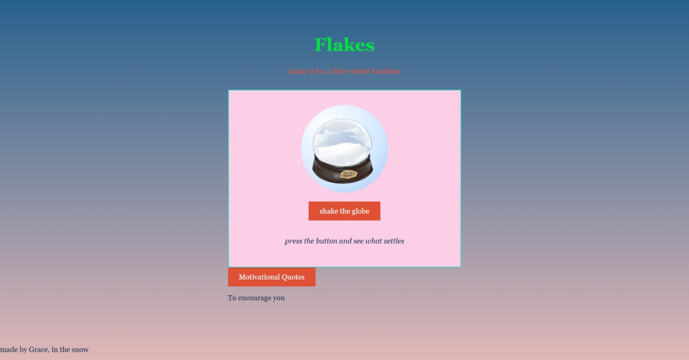

# Snowglobe

A simple website — click the shake button, the globe shakes, and you get a kind word.

## Screenshot

## Try It

[Demo Link](https://temi-ay.github.io/Snowglobe/)

Just open the link and give it a try.

## Features

- **Globe** — shakes when you click the button
- **Kind Messages** — kind words appear with every shake
- **Motivational Quotes** — click to reveal motivational quotes below

## How It Works

- **HTML** — page structure
- **CSS** — styling and globe shake animation
- **JavaScript** — messages, quotes, and interactivity

## Made By

[Grace](https://github.com/Temi-ay)
